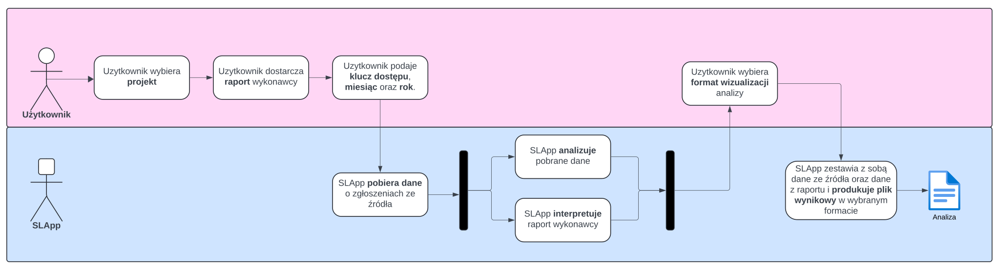
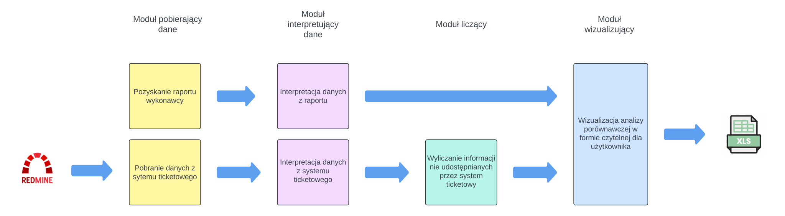
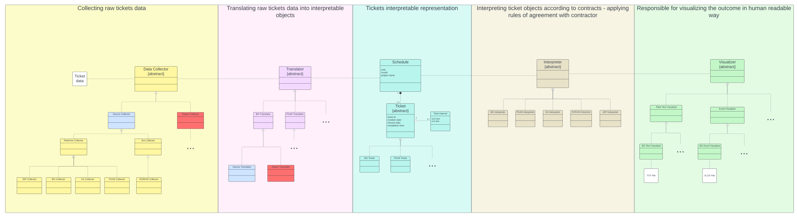

# SLApp
### Projects' SLA analysis application for clerk employees of the City Hall

### Video tutorial
https://github.com/JeremiJL/SLApp/blob/main/documentation/video-tutorial-piuw.mp4

### Documentation

#### Flowchart

#### Modularization

#### Class diagram

Author: _Jeremi Lipniacki_